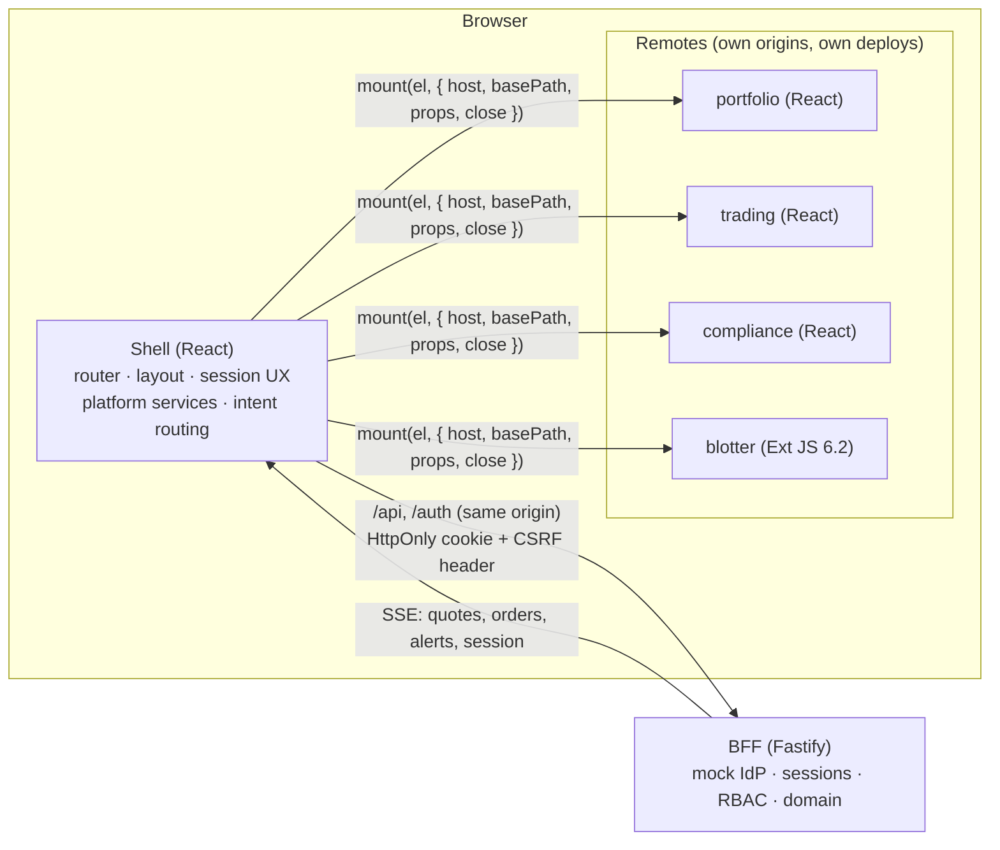

# Meridian

Proof of concept of a portfolio-management workspace (order management, portfolio analytics,
compliance) composed from independently deployed micro-frontends, including a legacy
**Sencha Ext JS** module running as a peer of React modules.

| Layer       | Choice                                                                                              |
| ----------- | --------------------------------------------------------------------------------------------------- |
| Monorepo    | Nx 23 (integrated), TypeScript 6, module boundaries enforced by lint tags                           |
| Composition | Module Federation 2 on Rsbuild 2 / Rspack 2, runtime remote registry                                |
| Shell       | React 19, React Router 7, MUI 9, TanStack Query 5                                                   |
| Remotes     | `portfolio`, `trading`, `compliance` (React 19); `blotter` (Ext JS 6.2 classic, GPL build vendored) |
| Backend     | Fastify 5 Backend-for-Frontend: sessions, RBAC/entitlements, REST + SSE, simulated domain           |
| Identity    | **Mocked** persona sign-in page served by the BFF; everything after sign-in is real                 |

Nothing is deployed. The Docker/nginx files are the reference production topology and are
verified locally only.

## What it demonstrates

| Concept                          | Mechanism                                                                                                                             | Where to see it                                             |
| -------------------------------- | ------------------------------------------------------------------------------------------------------------------------------------- | ----------------------------------------------------------- |
| Framework-agnostic composition   | Every exposed module is `{ hostContract, mount(el, ctx) → { update, unmount } }`; one `RemoteOutlet` mounts React and Ext JS alike    | _Orders_ (Ext JS) and _Portfolios_ (React) under one shell  |
| Independent deployability        | Remote URLs come from `/config/remotes.json` at runtime; the shell checks `hostContract` against `HOST_CONTRACT_VERSION` before mount | _Platform → Micro-frontends_                                |
| Shell → remote                   | Props via `update()` without remount; shared state via `host.state`                                                                   | _Trading desk_: blotter row count; top-bar portfolio picker |
| Remote → remote                  | Typed events (`order.focused`, `security.focused`) and intents (`trade.ticket.open`, `order.open`) routed by the shell                | _Trading desk_ message-flow panel; _Buy_ from Holdings      |
| Server → everyone                | One SSE connection per tab, filtered per user by permission and entitlement                                                           | Order fills update blotter, approvals and notifications     |
| Authentication and authorisation | BFF session cookie; RBAC + portfolio entitlements on every route and pushed event; four-eyes on approvals                             | Sign in as _Taylor_ (analyst): hidden in UI, refused by API |
| Fault isolation                  | Load timeout, error boundary and guarded teardown per mount; one failing remote degrades alone                                        | _Platform → Resilience drill_                               |
| Web security baseline            | Strict CSP (nonce + `'strict-dynamic'`), Fetch Metadata, CSRF, rate limits, graceful shutdown                                         | Response headers of `/`; `apps/bff/src/http`                |

## Decisions

Each decision is recorded as an ADR in [docs/adr](docs/adr). The trade-offs are the part worth
reading.

| ADR                                                   | Decision                                                                                                 | Why                                                                                                  | Cost accepted                                                                       |
| ----------------------------------------------------- | -------------------------------------------------------------------------------------------------------- | ---------------------------------------------------------------------------------------------------- | ----------------------------------------------------------------------------------- |
| [0001](docs/adr/0001-remote-lifecycle-contract.md)    | Lifecycle contract instead of rendering remote React components inside the host tree                     | Ext JS and React must be peers; no React version or context coupling between teams                   | Each mount owns a root; shell overlays use `disableEnforceFocus` (two focus traps)  |
| [0002](docs/adr/0002-share-policy.md)                 | Share only the React family; each remote bundles its own MUI with a unique Emotion cache                 | Teams upgrade UI libraries independently; avoids split theme contexts between shared and bundled MUI | Larger downloads; Emotion "loaded twice" console warning                            |
| [0003](docs/adr/0003-extjs-integration.md)            | Ext JS as a federated remote: global runtime, `scopeCss`, `HostProxy` over `host.http`, token-based skin | Keep the legacy module idiomatic and maintainable by Ext developers until it is migrated             | `'unsafe-eval'` in CSP; ES-module strict mode forbids `callParent()`                |
| [0004](docs/adr/0004-bff-session-auth.md)             | BFF sessions; tokens never reach the browser                                                             | IETF OAuth 2.0 for Browser-Based Apps recommends BFF for sensitive workloads                         | Session store must become shared (Redis) for more than one BFF instance             |
| [0005](docs/adr/0005-communication-model.md)          | Four mechanisms: shared state, events, intents, URL, each for one job                                    | Prevents a global event bus from becoming the integration layer                                      | Contracts must be versioned and reviewed centrally                                  |
| [0006](docs/adr/0006-design-tokens.md)                | Design tokens are the single source: MUI theme and `--mrd-*` CSS variables consumed by the Ext JS skin   | One look, dark mode and density for React and Ext JS with no Ext code                                | Skin depends on Triton class names; re-verify on an Ext upgrade                     |
| [0007](docs/adr/0007-strict-csp.md)                   | Strict CSP (nonce + `'strict-dynamic'`), no host allow-list                                              | Google's measurement: ~95% of allow-list policies are bypassable                                     | nginx must inject a nonce per response (`sub_filter`); Ext JS needs `'unsafe-eval'` |
| [0008](docs/adr/0008-module-federation-over-piral.md) | Module Federation 2 over Piral for the Ext JS migration                                                  | Ecosystem size, Rspack/Nx support, no proprietary feed service                                       | Registry, contract checks and diagnostics are built in-house                        |

## Architecture



**Composition at runtime.** The shell fetches `/config/remotes.json` (validated per entry; a bad
entry disables only that remote), registers remotes with Module Federation, loads them from their
`mf-manifest.json` with a timeout, and pre-loads a remote when its navigation item is hovered or
focused. Production bundles of remotes contain no dev host and no HTML.

**Host API.** The only coupling a remote has. `createPlatform()` issues a scoped, frozen instance
per remote, so events, HTTP calls (`x-meridian-client`) and telemetry are attributed automatically.

| Service         | Purpose                                                                                                       |
| --------------- | ------------------------------------------------------------------------------------------------------------- |
| `auth`          | Session document, `hasPermission`, `canAccessPortfolio`, sign-out                                             |
| `http`          | Fetch wrapper: CSRF, W3C `traceparent`, timeouts, RFC 9457 errors, central 401 handling, zod response parsing |
| `events`        | Typed pub/sub for facts; frozen envelopes; handler failures isolated                                          |
| `intents`       | Typed requests handled by the shell; payloads validated; permission-checked                                   |
| `state`         | Read-only cross-cutting state (theme, density, locale, workspace portfolio)                                   |
| `navigation`    | Shell-owned URL: read, navigate, subscribe                                                                    |
| `marketData`    | Quotes multiplexed over one SSE connection, coalesced per animation frame                                     |
| `notifications` | Toasts and the notification centre                                                                            |
| `flags`         | Server-evaluated feature flags                                                                                |
| `telemetry`     | Events, errors, timings; batched with `sendBeacon`                                                            |

**Exposed modules.** `portfolio/App`, `portfolio/SummaryWidget`; `trading/App`,
`trading/OrderTicket`, `trading/MoversWidget`, `trading/SecurityInsight`; `compliance/App`,
`compliance/AlertsWidget`; `blotter/App`, `blotter/RecentOrdersWidget`. The shell lists them once in
`apps/shell/src/app/modules.ts`.

**State.**

| Kind                   | Owner                                 | Tooling                                                                                      |
| ---------------------- | ------------------------------------- | -------------------------------------------------------------------------------------------- |
| Server state           | Each remote                           | TanStack Query (React), Ext data stores via `HostProxy`; invalidated by server push          |
| Real-time state        | Platform                              | One `EventSource`, quote cache, per-frame fan-out                                            |
| Cross-cutting UI state | Shell                                 | zustand vanilla store exposed read-only; `useSyncExternalStore` in React, `subscribe` in Ext |
| URL                    | Shell router, mirrored to each remote | Memory router per React remote synced with the shell URL                                     |

**Ext JS integration.** `defineExtRemote()` adapts an Ext view to the contract and keeps it sized
with a `ResizeObserver`. Ext view controllers extend `Blotter.view.HostViewController` (host
subscriptions, dispatch, focus, flash, density and locale). Ext classes are ES modules, so
`this.callParent()` is never used (Ext 6 resolves it through `Function.caller`, which is null in
strict mode); superclasses are called explicitly. Details: [apps/blotter/README.md](apps/blotter/README.md).

## Security model

Controls follow Google's published practices (strict CSP, Fetch Metadata resource isolation,
SRE-style operability, SLSA-oriented supply chain). The mapping, STRIDE threat model and the path
to production are in [docs/security-architecture-review.md](docs/security-architecture-review.md).

| Control           | Implementation                                                                                                                                                                                                        |
| ----------------- | --------------------------------------------------------------------------------------------------------------------------------------------------------------------------------------------------------------------- |
| Session           | Server-side store; cookie `HttpOnly`, `SameSite=Strict`, `__Host-` + `Secure` under TLS; new id at sign-in; idle 15 min extended only by user activity; absolute 8 h                                                  |
| Request integrity | Per-session CSRF token (constant-time compare) on unsafe methods; `Origin` allow-list; Fetch Metadata policy; `Origin: null` accepted only with `Sec-Fetch-Site: same-origin`                                         |
| Authorisation     | `requireSession` → `requirePermission` (fails closed) → portfolio entitlement on every route; the same rules filter each SSE connection; four-eyes on approvals; compliance fields withheld without `compliance:read` |
| Input validation  | zod on bodies, query strings and route params; 64 KiB body limit; RFC 9457 problem documents, no stack traces                                                                                                         |
| Abuse limits      | 600 requests/min keyed on the hashed validated session (else client IP behind `TRUST_PROXY_HOPS`); 5 SSE streams per session; `/healthz` exempt                                                                       |
| Browser hardening | Strict CSP with a fresh nonce per response in nginx; COOP, CORP, `nosniff`, `frame-ancestors 'none'`, HSTS under TLS; `Cache-Control: no-store` on financial data                                                     |
| Operability       | W3C trace id on every request and in every error; `SIGTERM` drains SSE streams and exits within a deadline; liveness endpoint; structured logs with secret redaction                                                  |
| Supply chain      | Lockfile, `npm ci --ignore-scripts`, audit gate, Dependabot, CodeQL, dependency review, provenance/SBOM on image builds; Ext JS vendored with an SRI lock                                                             |

## Mocked versus production-ready

| Area                    | POC                                          | Production change                                                                      |
| ----------------------- | -------------------------------------------- | -------------------------------------------------------------------------------------- |
| Identity provider       | Persona picker served by the BFF             | OIDC authorization-code flow in the BFF; routes, cookies and sessions stay as they are |
| Session and event store | In-memory, single process                    | Redis (or Memorystore) for sessions and pub/sub fan-out                                |
| Domain data             | Deterministic simulation (`SIMULATION_SEED`) | Order management, market data and compliance services behind the BFF                   |
| Ext JS runtime          | Ext JS 6.2.0 GPL build                       | Licensed build dropped into `apps/blotter/public/vendor`                               |
| Deployment              | `docker compose` reference topology          | Per-remote pipelines publishing manifests; registry rendered per environment           |

## Run

Requires Node.js 22.12 or newer (`.nvmrc`) and npm 10.

```bash
npm ci
npm start                     # shell :4200, remotes :4201–:4204, BFF :3333
```

Sign in at http://localhost:4200 by choosing a persona.

| Persona      | Role                              | Exercises                                                        |
| ------------ | --------------------------------- | ---------------------------------------------------------------- |
| Alex Morgan  | Portfolio manager (GEQ, USV, ESG) | Holdings → Buy/Sell intents → order ticket; compliance approvals |
| Jordan Patel | Execution trader (all funds)      | Ext JS blotter: route, cancel, live fills                        |
| Sam Rivera   | Compliance officer                | Approvals queue; four-eyes rule                                  |
| Taylor Kim   | Read-only analyst (GEQ, TEC)      | Least privilege: hidden in UI and refused by API                 |
| Riley Chen   | Platform admin                    | Registry, flags, event bus, telemetry, resilience drill          |

Other commands:

```bash
npx nx serve blotter && npx nx serve bff        # one remote standalone (dev host)
npx nx run-many -t typecheck lint test build    # must stay green
npx prettier --check .                          # formatting
docker compose up --build                       # reference topology on :8080 (local only)
npm run vendor:extjs                            # re-fetch Ext JS, SRI-verified
```

## Verification practice

No end-to-end suite by design. Changes are verified by typecheck, lint and production builds for
all projects, plus driving the running app in headless Chromium with real in-app navigation,
reading screenshots and console errors for every persona in light and dark mode. The BFF security
controls are re-exercised with scripted exploit attempts after each change. Current state and the
log of findings live in [docs/STATUS.md](docs/STATUS.md).

## Repository layout

```
apps/
  shell/          host: router, RemoteOutlet, layout, platform pages, intents wiring, remote registry
  portfolio/      React remote: portfolios, live holdings, performance, risk
  trading/        React remote: market watch, order ticket, movers and security-insight widgets
  compliance/     React remote: approvals, limit utilisation, rulebook
  blotter/        Ext JS remote: order blotter, recent-orders widget, Material skin, vendored runtime
  bff/            Fastify BFF: mock IdP, sessions, guards, security hooks, domain simulation, REST, SSE
libs/shared/
  contracts/      Host API, lifecycle contract, events, intents, permissions, zod DTOs, problem helpers
  platform/       shell runtime: event bus, store, http, SSE, market data, session, intents, telemetry
  react-sdk/      defineReactRemote(), hooks
  ui/             MUI theme and shared components built from design tokens
  design-tokens/  colour, type, motion, layout tokens → MUI theme and CSS variables
  formatting/     locale-aware number, currency and date formatting (React and Ext JS)
  dev-host/       standalone harness for one remote
tools/mf/         shared Rsbuild/MF configuration, share policy, strict CSP
tools/scripts/    Ext JS vendoring (SRI), Material icon generation for Ext
deploy/docker/    multi-target Dockerfile, unprivileged nginx templates, registry renderer
docs/             architecture, security and architecture review, ADRs, status
```

## Configuration (BFF)

Validated at start-up in `apps/bff/src/config.ts`; an invalid value fails fast.

| Variable                           | Purpose                                                           | Default                                 |
| ---------------------------------- | ----------------------------------------------------------------- | --------------------------------------- |
| `NODE_ENV`                         | `production` disables simulated latency and enables HSTS          | `development`                           |
| `HOST`, `PORT`                     | Bind address and port                                             | `127.0.0.1`, `3333`                     |
| `LOG_LEVEL`                        | pino level                                                        | `info`                                  |
| `PUBLIC_ORIGINS`                   | Origins allowed to send state-changing requests (comma separated) | shell and remote dev servers            |
| `COOKIE_SECURE`                    | `true` behind TLS: `Secure`, `__Host-` cookies                    | `false`                                 |
| `SESSION_IDLE_TIMEOUT_SECONDS`     | Idle timeout, extended only by user activity                      | `900`                                   |
| `SESSION_ABSOLUTE_TIMEOUT_SECONDS` | Maximum session length                                            | `28800`                                 |
| `TRUST_PROXY_HOPS`                 | Reverse proxies whose `X-Forwarded-For` entries are trusted       | `0` (`1` behind the nginx ingress)      |
| `AUTH_MODE`                        | Identity provider; `mock` is the only mode in this POC            | `mock`                                  |
| `SIMULATION_SEED`                  | Seed of the deterministic market and portfolio simulation         | `20261024`                              |
| `MARKET_TICK_MS`                   | Quote tick interval                                               | `1000`                                  |
| `SIMULATED_LATENCY_MS`             | Artificial API latency so loading states are visible              | `120` in development, `0` in production |

The shell reads its environment name from `remotes.json` (`ENVIRONMENT` rendered by the container
entrypoint); the shell artefact is identical in every environment.

## Known limitations

- Ext JS 6.2.0 is the last GPL-licensed release; production use requires a commercial licence.
- `'unsafe-eval'` stays in the CSP while Ext JS is hosted in-process; a sandboxed iframe is the fallback.
- All state is in memory and resets on BFF restart; a single BFF instance is assumed.
- Locale switching is partial (no plural rules); i18n is out of scope for the POC.
