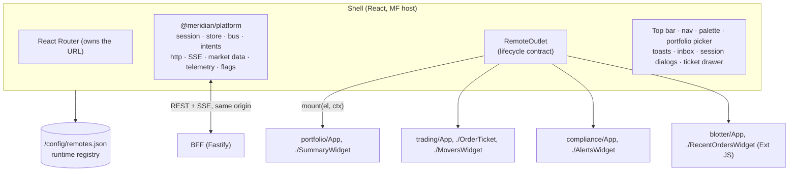

# Meridian architecture

Design overview in the style of a Google design doc: context, goals, the
design, and the alternatives considered. Individual decisions are recorded as
ADRs in [`adr/`](adr).

## Context

Investment-management front ends (order management, portfolio management,
compliance) are built by several teams on different release cycles, and
usually carry a legacy UI — often Sencha Ext JS — that cannot be rewritten in
one go. The workspace must nevertheless feel like **one product**: one
sign-in, one navigation, one look, one notification centre, consistent
permissions.

## Goals

1. Teams build, test and deploy their remote independently; the shell never
   needs a rebuild to pick up a new remote version.
2. A legacy Ext JS module runs inside the modern React shell as a
   first-class citizen (same contract, same services, same theme).
3. Production-grade cross-cutting concerns are implemented once, in the
   platform: authentication, authorisation, HTTP, real-time data, telemetry,
   feature flags, notifications, error isolation.
4. AAA-grade, accessible UI in the Google Material 3 / Cloud console idiom.

**Non-goals:** a real identity provider (mocked on purpose), persistence,
server-side rendering, mobile apps.

## System overview

### Composition

- **Module Federation 2** (`@module-federation/rsbuild-plugin`, Rspack 2).
  The shell registers remotes at runtime from `remotes.json`, loads them via
  their `mf-manifest.json`, and pre-loads a remote when its navigation item is
  hovered or focused.
- **Lifecycle contract** ([ADR-0001](adr/0001-remote-lifecycle-contract.md)):
  every exposed module is `{ hostContract, mount() → { update, unmount } }`.
  Pages and widgets use the same contract; the shell decides _where_ (route,
  dashboard card, side sheet) and _when_, the remote decides _how_.
- **Contract negotiation:** a remote declares the Host API range it supports
  (`^1.0.0`); the shell refuses to mount incompatible remotes with an explicit
  error rather than failing later in some code path.
- **Isolation:** each mount gets its own root (React root or Ext component),
  error boundary, query cache and Emotion cache. A remote that fails to load
  or crashes degrades to an inline error with retry; everything else keeps
  working.
- **Share policy** ([ADR-0002](adr/0002-share-policy.md)): only the React
  runtime is a shared singleton. UI libraries are bundled per remote.

### The Host API

The only thing a remote may depend on. Framework-agnostic (plain objects,
callbacks, promises) so Ext JS consumes it exactly like React does. Each
remote receives its own **scoped, frozen** instance: events it publishes, HTTP
calls it makes (`x-meridian-client`) and telemetry it emits are attributed to
it automatically.

| Service         | Purpose                                                                                                               |
| --------------- | --------------------------------------------------------------------------------------------------------------------- |
| `auth`          | Session, user, `hasPermission`, `canAccessPortfolio`, headers for a remote's own transport, sign-out                  |
| `http`          | Fetch wrapper: CSRF, W3C `traceparent`, attribution, timeouts, RFC 9457 errors, 401 handling, zod response validation |
| `events`        | Typed pub/sub for facts (`order.updated`, `security.focused`, …)                                                      |
| `intents`       | Typed requests to _whoever handles them_ (`trade.ticket.open`, `order.open`, …)                                       |
| `state`         | Read-only cross-cutting state (theme, density, locale, workspace portfolio)                                           |
| `navigation`    | Shell-owned URL: read, navigate, subscribe                                                                            |
| `marketData`    | Live quotes multiplexed over one SSE connection, coalesced per frame                                                  |
| `notifications` | Toasts and the persistent notification centre                                                                         |
| `flags`         | Server-evaluated feature flags (+ local overrides outside production)                                                 |
| `telemetry`     | Events, errors and timings, batched via `sendBeacon`                                                                  |

## Communication between remotes

Four mechanisms, each for one job ([ADR-0005](adr/0005-communication-model.md)):

| Mechanism                       | Use it for                                    | Example                                                                                                          |
| ------------------------------- | --------------------------------------------- | ---------------------------------------------------------------------------------------------------------------- |
| **Shared state** (`host.state`) | Long-lived context every module follows       | Picking _Global Equity Growth_ in the top bar filters the Ext JS blotter and opens it in Portfolios              |
| **Events** (`host.events`)      | Facts, many listeners, publisher doesn't care | `order.updated` (pushed by the BFF) updates the blotter grid, the compliance queue and the shell's notifications |
| **Intents** (`host.intents`)    | "Please do X" without knowing who does it     | Portfolio's _Buy_ button → `trade.ticket.open` → the shell mounts `trading/OrderTicket` in a side sheet          |
| **URL** (`host.navigation`)     | Shareable, bookmarkable location              | `/orders?focus=ORD-24118` selects and flashes that row in the blotter                                            |

The **Trading desk** page (`/desk`) shows these flows live, between three
independently deployed modules:

- **Ext JS → React:** selecting an order in the Ext JS blotter publishes
  `order.focused`, and the React _Security insight_ follows it.
- **React → Ext JS and React:** picking a security in _Market movers_
  publishes `security.focused`, which filters the Ext JS blotter.
- **Shell → Ext JS:** a shell control changes the blotter's `limit` prop
  through `update()`, without a remount.
- A _Message flow_ panel lists every message crossing a boundary, attributed
  to its source.

The shell owns intent routing, so a remote never learns another remote's
routes or component names, and permission checks happen centrally (an analyst
dispatching `trade.ticket.open` is refused by the shell).

## State management

| Kind                   | Where                                                   | Tooling                                                                                                             |
| ---------------------- | ------------------------------------------------------- | ------------------------------------------------------------------------------------------------------------------- |
| Server state           | Inside each remote                                      | TanStack Query (React), Ext data stores (blotter) — invalidated by server push                                      |
| Real-time state        | Platform                                                | One `EventSource`, quote cache with per-frame fan-out                                                               |
| Cross-cutting UI state | Shell                                                   | zustand vanilla store, exposed read-only through `host.state` (`useSyncExternalStore` in React, `subscribe` in Ext) |
| Local UI state         | Component                                               | React state / Ext ViewModel                                                                                         |
| URL state              | Shell router, mirrored into each remote's memory router | React Router 7                                                                                                      |

Persisted preferences (theme, density, workspace portfolio) are stored per
user; snapshots are frozen and referentially stable.

## Authentication and authorisation

[ADR-0004](adr/0004-bff-session-auth.md). Backend-for-Frontend pattern: the
browser holds only an opaque, `HttpOnly`, `SameSite=Strict` session cookie
(`__Host-` prefixed under TLS). Tokens never reach JavaScript.

- **Sign-in:** the shell redirects to `/auth/login?returnTo=…`. The mock IdP
  page (no JavaScript, nonce-based CSP, login-CSRF state token) creates a fresh
  session (no fixation) and redirects back to a sanitised same-origin path.
- **Session lifecycle:** idle timeout extended only by _user activity_
  (throttled keep-alive) — never by background polling or the SSE stream;
  absolute timeout; warning dialog with countdown; cross-tab sign-out via
  `BroadcastChannel`; any 401 surfaces a re-authentication dialog that
  preserves the deep link.
- **Request protection:** CSRF token on unsafe methods (constant-time
  comparison), `Origin` allow-list, Google's **Fetch Metadata** resource
  isolation policy, rate limiting, `Cache-Control: no-store` on financial
  data.
- **Authorisation:** role → permission mapping lives server-side; the client
  only sees effective permissions. Every route checks permissions (RBAC) _and_
  portfolio entitlements (ABAC); pushed SSE events are filtered per user the
  same way. The UI hides what you cannot do (`<Can>`, nav filtering, Ext
  ViewModel flags) — purely as UX.

## Sencha Ext JS integration

[ADR-0003](adr/0003-extjs-integration.md). The blotter is idiomatic Ext JS
MVVM (`Ext.define` models, ViewModel formulas, ViewController, grouped grid,
XTemplates). The integration layer is small:

- `defineExtRemote()` adapts an Ext view to the lifecycle contract and keeps
  it sized with a `ResizeObserver` (classic components are not fluid).
- Ext JS is loaded once per page from the remote's own origin, with
  `Ext.scopeCss = true` so it never styles `<body>`.
- `Blotter.data.HostProxy` — a custom Ext proxy over `host.http` — gives the
  legacy data layer CSRF, tracing and 401 handling without rewriting stores.
- The Triton theme is re-skinned to Material 3 using the **same design tokens**
  (as CSS variables), so light/dark and density switch with zero Ext code;
  icons are the same Material icons, generated as CSS masks.

## Design system

[ADR-0006](adr/0006-design-tokens.md). Google Material 3 / Cloud console
idiom: tonal frame with a rounded content panel, Google Sans + Roboto,
restrained elevation, pill buttons, 4 px grid. Tokens live in
`@meridian/design-tokens` and feed both the MUI theme and CSS variables.
Contrast of every text role is verified against WCAG AA by unit tests, and the
categorical chart palette was validated for lightness band, chroma, CVD and
normal-vision separation in both modes. Charts follow one-axis, legend +
table-view rules; status is never conveyed by colour alone.

## Observability

- W3C trace context on every request; the BFF logs with the caller's trace id
  and returns it in errors (`traceId` in problem documents, `x-trace-id`).
- Client telemetry (events, errors, timings, Core Web Vitals via `web-vitals`)
  is batched and sent with `navigator.sendBeacon`; remote load and mount
  timings are recorded per module.
- The _Platform_ page shows live registry status, contract versions, the
  event bus and telemetry — the first stop when diagnosing a composed UI.
- **Resilience drill** (_Platform → Micro-frontends_): take a remote "offline"
  and watch only its pages and widgets degrade to a contained error with
  Retry, while the rest of the workspace keeps working. A malformed registry
  entry is handled the same way: it disables only that remote.

## Performance

- Remotes load per route; nav hover/focus pre-loads manifests and entries.
- Real-time updates are coalesced per animation frame and filtered per
  subscriber; grids re-render only changed rows.
- Content-hashed assets are immutable; manifests, entries, `index.html` and
  `remotes.json` revalidate, so a deployment is visible immediately.
- Boot critical path: session + registry fetched in parallel; a static splash
  renders before JavaScript.

## Security

The full review, including a STRIDE threat model, controls mapped to Google's
published practices, scalability and the path to production, is in
[security-architecture-review.md](security-architecture-review.md).

**Headers.** Strict CSP ([ADR-0007](adr/0007-strict-csp.md)):

- a nonce on the shell's entry scripts and `'strict-dynamic'` for everything
  they load (remotes, Ext JS), with no host allow-list;
- enforced in development, and in production with a fresh nonce per response;
- `'unsafe-eval'` is required by Ext JS (XTemplate compiles functions), the
  main documented cost of hosting the legacy module. Migrating it, or isolating
  it in a sandboxed iframe, are the long-term options.

Also COOP, CORP, `X-Frame-Options`, `nosniff`, Permissions-Policy, and HSTS
under TLS.

## Alternatives considered

- **Share the whole UI stack (MUI, Emotion, router) as singletons.** Smaller
  downloads, but couples every team's upgrade cadence and risks theme-context
  mismatches between MF-shared and bundled MUI entry points. Rejected for a
  POC that prioritises independent deployability.
- **Render React remotes inside the shell's React tree** (Nx default). Simpler
  routing, but couples React versions and contexts, and makes Ext JS a special
  case. Rejected in favour of one lifecycle contract.
- **iframe for the Ext JS module.** Strongest isolation (CSP, globals), but
  poor UX integration (dialogs, focus, theming, deep links). Kept as the
  fallback if CSP requirements become non-negotiable.
- **Piral (app shell + pilets + feed service)** instead of Module Federation.
  Batteries included, but a much smaller ecosystem with one main maintainer, no
  Rspack 2 or Nx support, and a closed-source production feed; the Ext JS work
  would be the same. See [ADR-0008](adr/0008-module-federation-over-piral.md).
- **Tokens in the browser (SPA + OIDC PKCE).** Simpler infrastructure, but
  exposes tokens to XSS; financial workloads warrant the BFF pattern.
