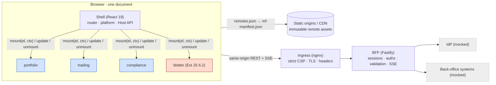

# Meridian — security & architecture review

**Scope:** the Meridian POC: a React shell, three React remotes and one Sencha Ext JS 6.2 remote
composed with Module Federation 2 in an Nx monorepo, behind a Backend-for-Frontend (BFF).
**Date:** 25 October 2026. **Status:** reviewed, findings fixed and re-verified (see §6).

## 1. Summary

The POC is **production-shaped**. Only two things are simulated: the identity provider (a
persona picker) and the back-office systems (an in-memory order and portfolio book). Every
control between them is real and runs in the demo: sessions, CSRF defences, authorisation,
validation, rate limiting, CSP, telemetry and isolation between micro-frontends.

- **Security model.** The BFF is the only party that ever holds credentials. The browser gets an
  opaque `HttpOnly`, `SameSite=Strict` cookie and nothing else. Every API route and every
  server-pushed event is authorised server-side (deny by default), down to field level.
- **Google practices.** We follow Google's published web-security playbook:
  - strict CSP (nonce + `'strict-dynamic'`) instead of host allow-lists;
  - Fetch Metadata resource isolation;
  - `__Host-` cookies;
  - W3C Trace Context;
  - SRE golden signals;
  - SLSA provenance and SBOMs;
  - OWNERS-style code ownership.

  §3.2 maps each practice to its implementation and its status.

- **Scalability.** Teams build and release remotes independently. A release is a static
  upload plus a registry change, never a shell rebuild. The runtime registry also gives
  per-remote rollback. At runtime the browser holds one multiplexed SSE connection, and assets
  are immutable and CDN-cacheable. The BFF is stateless apart from two in-memory adapters that
  become shared services in production (§4).
- **Verification.** Four independent reviews raised 44 findings. Every one was verified
  against the code, the exploitable ones were reproduced, and all were fixed and re-tested in a
  browser (§6).
- **To production (§8).** Real OIDC IdP, shared session store and pub/sub, distributed rate
  limiting, CSP and Trusted Types reporting, SLO dashboards, and a commercial Ext JS licence.

## 2. Architecture at a glance

The decisions that carry the design:

| Decision                                                                                         | Why                                                                                           | Record                                               |
| ------------------------------------------------------------------------------------------------ | --------------------------------------------------------------------------------------------- | ---------------------------------------------------- |
| One framework-agnostic lifecycle contract (`mount → { update, unmount }`) for React _and_ Ext JS | Legacy and modern code are both first-class; the shell never learns a remote's framework      | [ADR-0001](adr/0001-remote-lifecycle-contract.md)    |
| Runtime registry (`/config/remotes.json`) instead of build-time remotes                          | Release, canary or roll back one remote without rebuilding the shell                          | [architecture](architecture.md)                      |
| Share only the React runtime                                                                     | No cross-team version lock-step for UI libraries                                              | [ADR-0002](adr/0002-share-policy.md)                 |
| Scoped, frozen Host API (auth, http, events, intents, state, …)                                  | One audited place for cross-cutting concerns, attributed per remote                           | [architecture](architecture.md)                      |
| BFF with server-side sessions                                                                    | Tokens never reach JavaScript; authorisation and validation live server-side                  | [ADR-0004](adr/0004-bff-session-auth.md)             |
| Strict CSP with a per-response nonce                                                             | Allow-list CSPs are bypassable; trust flows from the shell to what it loads                   | [ADR-0007](adr/0007-strict-csp.md)                   |
| Module Federation 2 over Piral                                                                   | Larger, growing ecosystem; no new lock-in (our contract, open runtime); fits Nx and Rsbuild 2 | [ADR-0008](adr/0008-module-federation-over-piral.md) |

## 3. Security

### 3.1 Trust boundaries

1. **Browser document.** The shell and every remote share one page, so a remote runs with the
   page's privileges. Remotes are therefore trusted code. That is why they are
   **supply-chain controlled**: code review, `CODEOWNERS`, CI, provenance, and a
   registry operations controls. They are not sandboxed (§3.4).
2. **Ingress.** TLS termination, strict CSP and security headers; the BFF is reachable only
   through the shell's own origin, so cookies stay first-party.
3. **BFF.** It authenticates each request (session lookup), authorises it (RBAC, portfolio
   entitlements, field-level need-to-know, four-eyes), validates it (zod) and rate-limits it.
4. **IdP and back-office systems.** Mocked; in production they sit behind service-to-service
   authentication.

### 3.2 Controls mapped to Google's practices

| Practice (source)                                                                                                                             | What we do                                                                                                                                                                                                                                                  | Where                                                                                                    | Status                                  |
| --------------------------------------------------------------------------------------------------------------------------------------------- | ----------------------------------------------------------------------------------------------------------------------------------------------------------------------------------------------------------------------------------------------------------- | -------------------------------------------------------------------------------------------------------- | --------------------------------------- |
| **Strict CSP** ([web.dev/strict-csp](https://web.dev/articles/strict-csp); Weichselbaum et al., CCS 2016: ~95% of allow-list CSPs bypassable) | `script-src 'nonce-…' 'strict-dynamic'` with `object-src 'none'`, `base-uri 'none'` and `frame-ancestors 'none'`. Nonce is fresh per response in prod; HTML is `no-store`                                                                                   | [tools/mf/csp.ts](../tools/mf/csp.ts), [shell.conf.template](../deploy/docker/nginx/shell.conf.template) | Enforced (dev + prod)                   |
| **Fetch Metadata resource isolation** ([web.dev/fetch-metadata](https://web.dev/articles/fetch-metadata))                                     | Cross-site requests rejected except top-level navigations                                                                                                                                                                                                   | [security.ts](../apps/bff/src/http/security.ts)                                                          | Enforced                                |
| **Cookie hardening** (`__Host-` prefix, SameSite)                                                                                             | `__Host-mrd_session`: `HttpOnly`, `Secure`, `SameSite=Strict`, `Path=/`; 256-bit random id, rotated at sign-in                                                                                                                                              | [routes.ts](../apps/bff/src/auth/routes.ts)                                                              | Enforced (`__Host-`/`Secure` under TLS) |
| **No tokens in the browser** (IETF _OAuth 2.0 for Browser-Based Apps_: BFF pattern)                                                           | Server-side sessions; idle (15 min) and absolute (8 h) limits; keep-alive only on real user activity                                                                                                                                                        | [ADR-0004](adr/0004-bff-session-auth.md)                                                                 | Enforced (IdP mocked)                   |
| **CSRF defence in depth**                                                                                                                     | `SameSite=Strict` + per-session token (constant-time compare) + `Origin` allow-list + Fetch Metadata                                                                                                                                                        | [security.ts](../apps/bff/src/http/security.ts)                                                          | Enforced                                |
| **Zero-trust authorisation** ([BeyondCorp](https://research.google/pubs/beyondcorp-a-new-approach-to-enterprise-security/))                   | Every request authorised, never the network or the UI: • RBAC on every route • portfolio entitlements (ABAC) on REST _and_ SSE • field-level need-to-know (compliance posture) • four-eyes approvals • permission-checked intents       | [guards.ts](../apps/bff/src/auth/guards.ts), [stream.ts](../apps/bff/src/routes/stream.ts)               | Enforced                                |
| **Validate at every trust boundary**                                                                                                          | zod schemas on bodies, query strings and SSE events. Clients validate responses too. Pre-trade checks value orders at a conservative reference price                                                                                                        | [api.ts](../apps/bff/src/routes/api.ts), [pricing.ts](../apps/bff/src/domain/pricing.ts)                 | Enforced                                |
| **Abuse resistance**                                                                                                                          | Rate limits keyed on a _validated_ session (hashed) or the trusted client IP: 600/min global, 20/min sign-in, 120/min telemetry. Also enforced: • 5 SSE streams per session • body limits • trusted-proxy hop count • liveness probe exempt | [app.ts](../apps/bff/src/app.ts)                                                                         | Enforced (per instance; see §8)         |
| **Safe failure**                                                                                                                              | RFC 9457 problem documents with a trace id and no internals; the sign-in redirect target (`returnTo`) is resolved like a browser and must stay same-origin                                                                                                  | [problem.ts](../apps/bff/src/http/problem.ts)                                                            | Enforced                                |
| **Isolation headers** ([web.dev/coop-coep](https://web.dev/articles/coop-coep))                                                               | COOP `same-origin`, CORP `same-origin` (BFF), `X-Frame-Options: DENY`, `nosniff`, Permissions-Policy, HSTS under TLS                                                                                                                                        | [security-headers.conf](../deploy/docker/nginx/security-headers.conf)                                    | Enforced (COEP: §8)                     |
| **Trusted Types** ([web.dev/trusted-types](https://web.dev/articles/trusted-types))                                                           | Blocked by Ext JS, which writes `innerHTML` throughout. Plan: report-only now, enforce once the Ext views are migrated                                                                                                                                      | —                                                                                                        | Roadmap                                 |
| **Distributed tracing** (Dapper → [W3C Trace Context](https://www.w3.org/TR/trace-context/))                                                  | `traceparent` on every call; the BFF logs, errors and `x-trace-id` carry the trace id                                                                                                                                                                       | [http.ts](../libs/shared/platform/src/lib/http.ts)                                                       | Implemented                             |
| **SRE golden signals & SLOs** ([sre.google](https://sre.google/sre-book/monitoring-distributed-systems/))                                     | Structured logs (secrets redacted), client errors, uncaught errors, remote load timings and Core Web Vitals (LCP/INP/CLS). SLOs proposed in §5                                                                                                              | [telemetry.ts](../libs/shared/platform/src/lib/telemetry.ts)                                             | Signals: yes · dashboards: §8           |
| **Supply chain** ([SLSA](https://slsa.dev), [OSV](https://osv.dev))                                                                           | Lockfile and `npm ci --ignore-scripts`; audit gate on runtime dependencies (0 known today); dependency review on PRs; CodeQL; Dependabot; SLSA provenance and SBOM attestations on images                                                                   | [ci.yml](../.github/workflows/ci.yml)                                                                    | Configured (runs on GitHub)             |
| **Code ownership** (Google OWNERS files)                                                                                                      | Per-directory owners with mandatory review; security reviewers on the BFF, CSP and deploy paths                                                                                                                                                             | [CODEOWNERS](../.github/CODEOWNERS)                                                                      | Configured (teams are placeholders)     |
| **Enforced module visibility** (Bazel visibility → Nx tags)                                                                                   | A remote cannot import shell internals or another remote; the Ext remote cannot import React libs                                                                                                                                                           | [eslint.config.mjs](../eslint.config.mjs)                                                                | Enforced in lint                        |

### 3.3 Threat model (STRIDE)

| Threat                     | Example against Meridian                                                          | Controls                                                                                                                                                                              | Residual risk                                                             |
| -------------------------- | --------------------------------------------------------------------------------- | ------------------------------------------------------------------------------------------------------------------------------------------------------------------------------------- | ------------------------------------------------------------------------- |
| **Spoofing**               | Steal or fixate a session                                                         | `HttpOnly` cookie, strict CSP, id rotated at sign-in, login-CSRF state token, idle/absolute expiry, cross-tab sign-out                                                                | Real IdP needed (MFA, conditional access)                                 |
| **Tampering**              | Forged order actions; manipulated order fields                                    | `SameSite=Strict` + CSRF token + Origin + Fetch Metadata; zod validation; pre-trade valued at the worse of limit and market price (closes the "limit at 0.01" bypass found in review) | —                                                                         |
| **Repudiation**            | "I never approved that"                                                           | Orders carry creator and approver plus a justification; four-eyes rule; trace ids in all logs                                                                                         | Append-only audit store (production)                                      |
| **Information disclosure** | See another fund's orders; read compliance posture without the role               | Entitlements on REST and SSE fan-out; `null` compliance fields without `compliance:read`; `no-store` on financial data; log redaction                                                 | —                                                                         |
| **Denial of service**      | Rotate cookies to dodge limits; spoof `X-Forwarded-For`; open hundreds of streams | Limits keyed on a validated identity; trusted hop count; 5 streams per session; body and query bounds; liveness probe exempt                                                          | Limits are per instance until a shared store (§8); edge WAF/DDoS in front |
| **Elevation of privilege** | Analyst dispatches "open trade ticket"; PM approves own order                     | Deny-by-default route permissions; shell intent registry checks permissions; four-eyes enforced server-side; UI gating is UX only                                                     | —                                                                         |

### 3.4 Risks specific to micro-frontends

- **A compromised remote runs with page privileges.** This is true of any same-document
  composition, including Piral and iframe-less setups. Mitigations:
  - provenance, CODEOWNERS and CI gates on every remote;
  - only registry-listed origins are loaded, and operations own the registry;
  - strict CSP blocks injected scripts;
  - the Host API is scoped and attributed per remote.

  Untrusted third-party remotes would get an `<iframe>` with its own origin and CSP.

- **Contract skew between shell and remote.** Each remote declares the Host API range it
  supports, and the shell refuses incompatible remotes with a clear error instead of failing
  later.
- **Runtime coupling through shared dependencies.** Only React is a singleton. The cost is
  that each remote runs its own MUI instance. The review found two such MUI focus traps
  fighting each other; the shell now stops enforcing focus over content it doesn't own
  ([ADR-0002](adr/0002-share-policy.md)).
- **Legacy Ext JS cost.** CSP needs `'unsafe-eval'`, because `XTemplate` compiles
  functions. Trusted Types can't be enforced yet. Ext's feature detection produces one
  benign CSP report per load (an empty `on…=""` probe, blocked with no functional effect).

## 4. Scalability

### 4.1 Teams and delivery

| Concern              | How it scales                                                                                                                                                                                 |
| -------------------- | --------------------------------------------------------------------------------------------------------------------------------------------------------------------------------------------- |
| Independent releases | Each remote is its own build and deployable (static files). A release uploads assets and updates one registry entry; the shell is untouched. Rollback is the previous entry                   |
| Integration contract | `@meridian/contracts`: typed Host API, events, intents and DTOs, semantically versioned. A breaking change means a major version, with the shell supporting both ranges during the transition |
| Ownership            | `CODEOWNERS` per app and library; contract changes need platform and architecture approval                                                                                                    |
| Build cost           | Nx `affected` targets with computation caching: CI only builds and tests what a change touches. A remote cache (self-hosted or Nx Cloud) extends this across machines                         |
| Onboarding a team    | Generate a remote, implement `mount`, register a catalog entry (governed) and a registry entry (per environment)                                                                              |

### 4.2 Runtime

| Tier          | Today (POC)                                                                                                                         | At scale                                                                                                                                                                                                                                                                                |
| ------------- | ----------------------------------------------------------------------------------------------------------------------------------- | --------------------------------------------------------------------------------------------------------------------------------------------------------------------------------------------------------------------------------------------------------------------------------------- |
| Static assets | Content-hashed and immutable (`max-age=31536000`); manifests and `remotes.json` revalidate                                          | CDN in front of every remote origin; instant global rollout and rollback through the registry                                                                                                                                                                                           |
| Browser       | One SSE connection per tab, shared by all remotes; quotes coalesced per animation frame; route-level lazy loading; preload on hover | Unchanged: client cost does not grow with the number of remotes                                                                                                                                                                                                                         |
| BFF           | Stateless apart from the in-memory session store and the in-memory event hub                                                        | Horizontal autoscaling (e.g. Cloud Run or GKE). Sessions and rate limits move to a shared store (Memorystore/Redis); SSE fan-out moves to pub/sub (Pub/Sub or Redis Streams). Both sit behind small classes (`SessionStore`, `EventHub`) whose methods map directly onto those services |
| Edge          | nginx with security headers                                                                                                         | Global HTTPS load balancer with a WAF/DDoS layer (e.g. Cloud Armor); TLS and HSTS preload                                                                                                                                                                                               |

## 5. Reliability and operability

- **Fault isolation:**
  - each remote mount has its own React root, error boundary, query cache and style cache;
  - remote route errors are contained, with Retry;
  - a broken registry entry disables only that remote;
  - a throwing listener in one remote cannot stop reconnects, sign-out or other remotes'
    notifications.
- **Resilience drill (live in the demo).** _Platform → Micro-frontends → Resilience drill_
  takes a remote "offline". Its pages and widgets show a contained error while the rest of the
  workspace keeps working; switching it back on and pressing Retry recovers it.
- **Proposed SLOs** (Google SRE style; measured from the existing telemetry):

  | SLI                                          | Objective (30 days)                  |
  | -------------------------------------------- | ------------------------------------ |
  | API availability (non-5xx share of requests) | 99.9%                                |
  | API latency, p95 (excluding the stream)      | < 300 ms                             |
  | Remote mount success                         | 99.5%                                |
  | Live-stream connected time                   | 99% of session time                  |
  | Core Web Vitals at p75                       | LCP < 2.5 s, INP < 200 ms, CLS < 0.1 |

## 6. Verification performed

| Activity                                                                                                  | Result                                                                                                                                                                                                                |
| --------------------------------------------------------------------------------------------------------- | --------------------------------------------------------------------------------------------------------------------------------------------------------------------------------------------------------------------- |
| Four independent reviews: shell/platform runtime, React remotes, Ext JS remote, BFF + deployment security | 44 findings (14 + 12 + 11 + 7). All verified against the code; exploitable ones reproduced; all fixed or mitigated                                                                                                    |
| Exploit re-runs against the patched BFF                                                                   | Closed: limit-price compliance bypass, rate-limit bypass (junk cookies, spoofed `X-Forwarded-For`), open redirect via control characters, 500s on repeated query keys, unbounded SSE streams, compliance-posture leak |
| Headless-browser runs (all five personas, light and dark, real in-app navigation)                         | All pages, the Trading desk flows (Ext → React, React → Ext, shell → remote props), resilience drill, deep links, keyboard flows. No uncaught errors; one documented CSP report (Ext probe)                           |
| Strict CSP                                                                                                | Enforced in development across every page. In a local nginx container: fresh nonce per response, header and HTML match, `no-store`, `X-Frame-Options`                                                                 |
| Static checks                                                                                             | Typecheck and lint for all 13 projects (0 errors); `npm audit` on runtime dependencies: 0 vulnerabilities                                                                                                             |

Selected fixes, to show the depth of the review:

- The order ticket used a stale compliance result for gating.
- Two MUI focus traps fought each other (stack overflow).
- Ext JS records mutated shared event payloads.
- Triton's global `:focus{outline:none}` removed the keyboard focus ring.
- The session countdown trusted the client clock.
- The live stream kept reconnecting after sign-out.

## 7. Mocked vs production-ready

| Area              | POC                       | Production change                                                                                                  |
| ----------------- | ------------------------- | ------------------------------------------------------------------------------------------------------------------ |
| Identity          | Persona picker (mock IdP) | OIDC Authorization Code + PKCE at the BFF (Okta, Entra ID or Google Workspace); MFA by IdP policy. BFF-only change |
| Sessions          | In-memory store           | Shared store (Memorystore/Redis), encrypted at rest                                                                |
| Real-time fan-out | In-memory hub             | Pub/sub between BFF instances; same SSE contract                                                                   |
| Domain data       | Seeded simulation         | Back-office APIs via service-to-service auth                                                                       |
| Everything else   | Real                      | —                                                                                                                  |

## 8. Path to production (prioritised)

1. **P0:**
   - OIDC IdP integration;
   - shared session store and distributed rate limiter;
   - pub/sub fan-out;
   - TLS everywhere (`COOKIE_SECURE=true`, `__Host-` cookies, HSTS);
   - commercial Ext JS licence. Ext JS 6.x support ended in 2022; plan the 7.x/8.x upgrade
     or the migration.
2. **P1:**
   - CSP violation reporting endpoint (`report-to`) and a Trusted Types _report-only_ rollout;
   - SLO dashboards and alerting on the signals above;
   - pin CI actions and base images by digest;
   - unprivileged nginx image;
   - registry change control (who can repoint a remote) with an audit trail.
3. **P2:**
   - Subresource integrity or manifest signing for remote entries;
   - COEP / cross-origin isolation once every remote sends CORP;
   - per-remote performance budgets in CI;
   - a remote Nx cache.

## 9. Accepted trade-offs

- **`'unsafe-eval'` for Ext JS.** It disappears as Ext views are migrated to React; this is
  the strangler-fig path the architecture is built for.
- **Per-remote MUI.** It buys team independence at the cost of bytes and of the focus-trap
  coordination described above. The alternative is to adopt a shared UI release train and share
  `@mui/*` as singletons.
- **Same-document composition.** Better UX (focus, dialogs, theming, deep links) than iframes,
  in exchange for treating remotes as trusted, supply-chain-controlled code.
